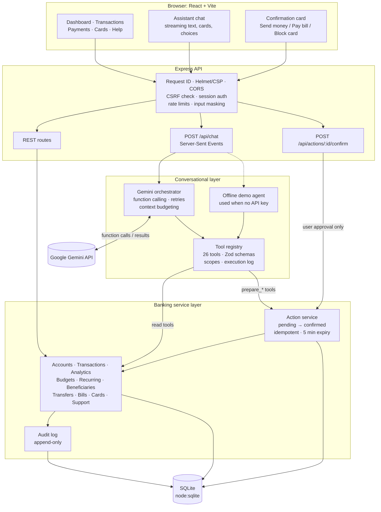
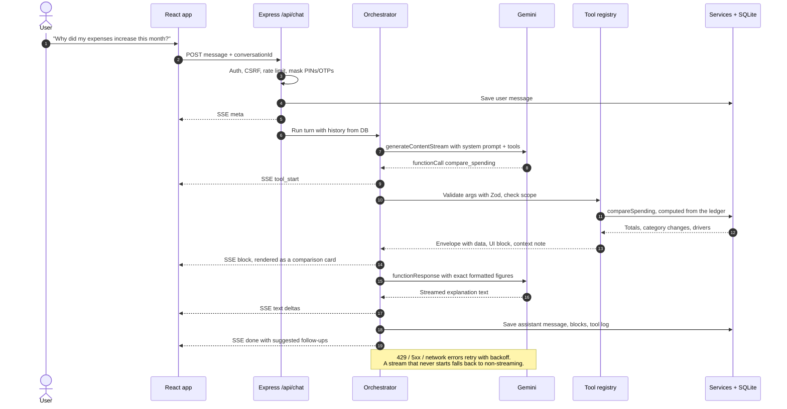
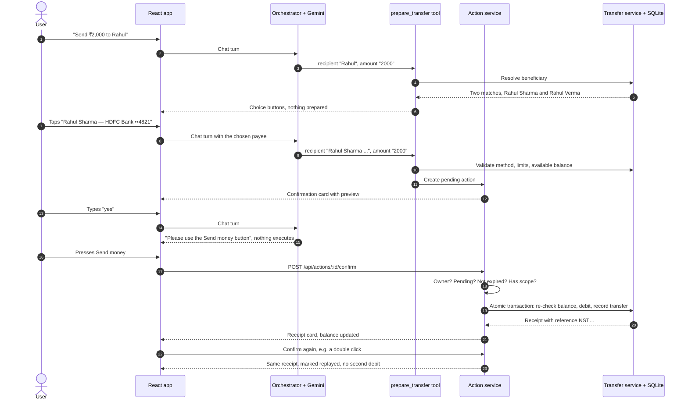
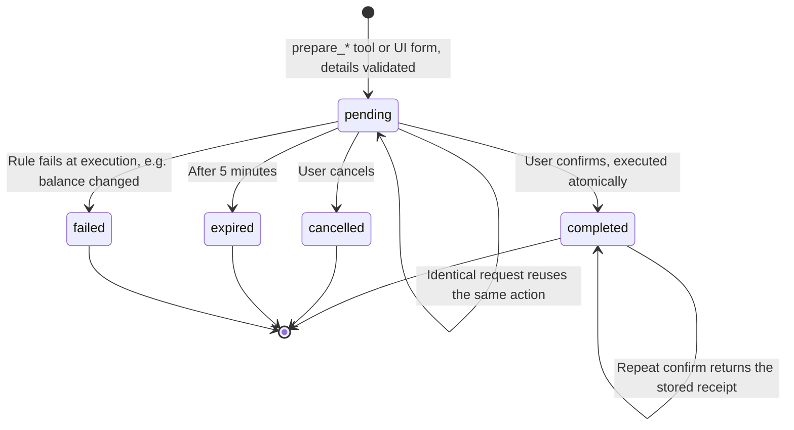
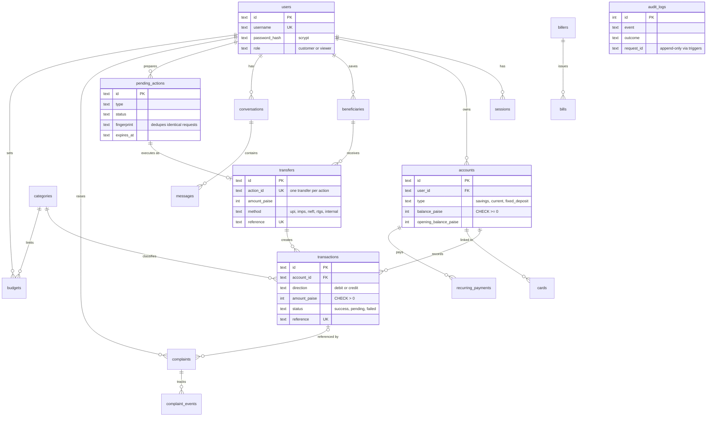

# Northstar Bank: Gemini banking assistant

A full-stack demo of a digital bank in which **Gemini is the conversational layer and the backend owns the truth**. Balances, analytics, transfers and card changes all come from a validated service layer over a SQLite ledger. The model can request tools; it cannot read the database, do the arithmetic, or move money.

> All data is mock data. No real bank accounts, UPI networks or payment rails are connected. The UI labels every payment as **Simulated**.

## Quick start

Requires **Node.js 22.13+** (uses the built-in `node:sqlite`; tested on Node 26).

```bash
npm run install:all          # root + backend + frontend dependencies
cp .env.example .env         # then set GEMINI_API_KEY (optional, see below)
npm run dev                  # API on :4000, web app on http://localhost:5173
```

Sign in with **`tejas` / `Northstar@2026`**. Other demo profiles: `aisha` (a second customer, used for authorization tests) and `meera` (read-only).

| Command | What it does |
|---|---|
| `npm run dev` | Backend (watch mode) + Vite dev server with `/api` proxy |
| `npm start` | Builds the frontend and serves everything from Express on `:4000` (production mode, CSP, single origin) |
| `npm test` | Backend unit + integration tests (`node --test`, Gemini mocked) |
| `npm run test:e2e` | Playwright end-to-end tests against the production build in demo-agent mode (uses your installed Chrome) |
| `npm run test:all` | Both |
| `npm run db:reset` | Delete and re-seed the local database |

Without `GEMINI_API_KEY` the app runs a **deterministic demo agent** (a keyword router, not an LLM) over the same tool registry, so every workflow works offline. With a key, Gemini handles natural language, multi-turn context and tool selection.

## Architecture

### System overview

Every request passes through the same middleware. The model only reaches banking data through the tool registry, and money only moves through the action service after the user approves.



### A chat turn

The orchestrator streams Gemini's output over Server-Sent Events. Tool results become UI cards built from verified data, and the model receives the exact formatted figures to explain.



### Transfer with clarification and confirmation



### Pending action lifecycle



### Data model (core tables)



**Rules the architecture enforces**

- The model only sees 26 declared tools. None of them executes money movement: `prepare_*` tools create a **pending action**, and only `POST /api/actions/:id/confirm`, triggered by a button on the confirmation card, executes it. Typing "yes" does nothing.
- Identity comes from the session. No tool or route accepts a user ID; every query is scoped by `user_id`.
- Every tool argument goes through a strict Zod schema (unknown keys rejected), then through service-level business rules (ownership, limits, balance).
- All money is **integer paise**. Inputs are parsed from decimal strings (`"1,499.50"` → `149950`), so floats are never used for arithmetic. Responses carry `{ paise, value, formatted }` so neither the UI nor the model re-derives figures.
- UI cards (balances, transactions, charts, previews, receipts) are rendered from tool results, not from model text.

## Features

**Accounts:** multiple accounts (savings, family savings, fixed deposit), masked numbers, ledger vs **available** balance (pending payments are held).

**Transaction intelligence:** search by merchant/text/reference, category, status, direction, channel, amount range and date range, with sorting and pagination. Also: per-transaction explanations (status meaning, failure reason, merchant history, duplicate check, linked complaint), duplicate-charge detection, unusual-spending detection (large vs your category median, big first-time merchants, category spikes), and recurring/subscription detection.

**Conversational analytics (deterministic backend functions):** monthly spending with category breakdown, month-over-month comparison including a like-for-like "same days last month" window and the transactions driving the increase, largest transactions, a 6-month trend, budget progress with projections, and "how much can I safely save" with a full breakdown and stated assumptions.

**Fund transfers:** saved beneficiaries or own accounts. The workflow: understand → collect missing fields → disambiguate (e.g. two "Rahul"s become tappable choices) → validate method rules (UPI ≤ ₹1L with a UPI ID, IMPS ≤ ₹5L, NEFT, RTGS ≥ ₹2L), the daily limit (₹2L), and available balance → preview → explicit confirmation → atomic execution → reference number (`NST…`) → receipt.

**Duplicate-transfer protection:**
1. Preparing an identical request while one is pending reuses it.
2. Confirming is idempotent: a replay returns the stored receipt.
3. `transfers.action_id` is `UNIQUE`.
4. Debits use a guarded `UPDATE … WHERE balance >= amount`.
5. A recent identical transfer raises a duplicate warning on the preview.

Requests expire after 5 minutes.

**Bills, cards, beneficiaries:** pay due bills; block a card temporarily (reversible) or permanently (lost, stolen, suspicious, damaged); unblock. Payees are added through a form whose details never pass through the LLM.

**Support:** grounded help-centre answers (failed/pending UPI, refunds, duplicates, card blocking, disputes, limits, escalation, security), complaint registration (deduplicated per transaction) with SLA dates and a timeline, tracking, escalation with helpline and grievance contacts.

**Interface:** a dashboard (balance band, accounts, income vs spending chart with tooltip and table view, category bars, budgets, upcoming payments, insights, recent transactions), a streaming chat with step indicators, cards, tappable choices, follow-up suggestions, copy, stop/retry and saved conversation history, plus Transactions, Payments, Cards and Help pages. It is responsive (tab bar on mobile), has light and dark themes, keyboard focus, and respects reduced motion.

## Gemini integration

- Official `@google/genai` SDK; the key stays server-side; model set by `GEMINI_MODEL` (default `gemini-3.8-flash`).
- Function declarations are generated from the same Zod schemas used for validation (`parametersJsonSchema`, `additionalProperties: false`).
- Multi-step loop (max 6 steps, 10 tool calls per turn, 5 parallel calls per step). Model turns are replayed with their **thought signatures** intact; duplicate calls within a turn run once.
- **Streaming** over SSE (`GEMINI_STREAMING=auto`): if a stream fails before its first chunk, the process falls back to `generateContent`.
- **Retries** with exponential backoff and jitter for 429/5xx/network errors. The server's `retryDelay` is honoured, with at most one long wait. Timeouts (`GEMINI_TIMEOUT_MS`) are retried at most once. 401/400 are never retried. Users see safe, specific messages, including how long to wait when rate-limited.
- Malformed output (empty response, `MALFORMED_FUNCTION_CALL`, nameless calls, unknown tools, invalid arguments) is handled: unknown or invalid calls are returned to the model as structured errors.
- **Context window:** history is loaded from the database (the client only sends the new message), newest-first within a message and character budget. Assistant turns carry a compact note of the record IDs they showed, so "explain the second one" works without replaying full tool payloads.
- **Grounding guard:** amounts in a reply that don't appear in that turn's tool data are logged as `unverified_amounts_in_reply`.

## Security

- scrypt password hashing; login lockout (5 failures → 15 minutes); identical error for unknown user and wrong password; login rate limit.
- Opaque session tokens (only a SHA-256 is stored) in an `HttpOnly; SameSite=Strict` cookie scoped to `/api` (`Secure` in production), with absolute and idle expiry and server-side logout.
- CSRF: required `X-Requested-With` header plus an Origin allowlist. Helmet security headers and a strict CSP. CORS allowlist.
- Role scopes (`customer`, read-only `viewer`) checked per tool, per route and again at confirmation time.
- Rate limits on login, chat, confirmations and the general API.
- Strict validation at every boundary; 32 KB body limit; control and bidi characters stripped. Card numbers, account numbers, OTPs, PINs and passwords typed into chat are masked before storage or LLM processing.
- Prompt-injection defences: tool data is declared as untrusted, the model has no execution path, and confirmation is bound to an action ID owned by the session user.
- Structured JSON logs with request IDs and recursive redaction (secrets removed, account-like numbers masked). An append-only `audit_logs` table (DB triggers block UPDATE/DELETE) records logins, prepared/confirmed/denied/failed actions, transfers, bill payments, card changes, budgets and complaints. `tool_executions` logs every tool call with redacted arguments.
- Database constraints (CHECKs on amounts, statuses and balances ≥ 0, foreign keys, uniqueness) and `BEGIN IMMEDIATE` transaction boundaries.

## Environment variables

See [`.env.example`](.env.example). The ones you're most likely to set:

| Variable | Default | Purpose |
|---|---|---|
| `GEMINI_API_KEY` | empty | Enables Gemini; empty runs the offline demo agent |
| `GEMINI_MODEL` | `gemini-3.8-flash` | Gemini model name |
| `GEMINI_TIMEOUT_MS` | `90000` | Per-request timeout |
| `GEMINI_STREAMING` | `auto` | `auto`, `on` or `off` |
| `PORT` | `4000` | API port |
| `DATABASE_PATH` | `backend/data/northstar.db` | SQLite file |
| `DEMO_ANCHOR_DATE` | today | Pins "today" so demo data and "this month" are reproducible |

## Tests

- **Backend: 82 tests** (`npm test`).
  - Money parsing and formatting, periods, the ledger invariant, balances and holds.
  - Search and filtering, spending versus independent SQL, month-over-month consistency, top transactions, duplicates, unusual spending, savings formula, budgets, recurring payments.
  - Beneficiary ambiguity; missing transfer parameters; insufficient balance; method and daily limits; confirmation; idempotent replay; deduped prepares; the DB unique constraint; cancel and expiry; cross-user and read-only denial; balance changing between preview and confirm.
  - Bills, cards and complaints.
  - Gemini orchestration with a scripted mock client: thought signatures; 429, 503, 401, timeouts, network errors and server `retryDelay`; the streaming fallback; empty, safety and malformed responses; hallucinated tools; invalid arguments; loop limits; context trimming.
  - HTTP: auth, cookies, lockout, CSRF, headers, authorization isolation, SSE transfer with confirm and replay, viewer restrictions, input masking, rate limits, history.
- **End-to-end: 21 Playwright tests** (`npm run test:e2e`), including axe-core accessibility checks (Lighthouse's agentic accessibility-tree rule set, in light and dark mode), a layout-shift budget, keyboard checks and discovery-file checks. Sign in and out; the ambiguous transfer, then approval, then an exact balance change; typed "yes" not executing plus cancel; analytics cards; history reopening; card block and unblock; bill payment; transaction filters and details; the read-only profile; mobile navigation without horizontal scroll.

The suite contains no LLM evaluation: Gemini is mocked so the tests are repeatable and free.

## Frontend performance and discoverability

- Measure with **`npm start`** (minified, code-split, Brotli pre-compressed), not `npm run dev`. The Vite dev server is never minified, so Lighthouse always reports about 1 MB of minification and unused-JS "savings" there.
- Only the dashboard ships in the initial bundle; other pages load on demand. React is a separate long-cached chunk.
- Fonts are self-hosted (DM Sans and Manrope, SIL OFL), subset with fontTools to the characters and weights the app uses (about 57 KB total), and preloaded; no third-party font requests.
- On the dashboard route, startup requests begin before React renders and `/api/auth/me?include=dashboard` returns the session and dashboard together, so the balance needs one API round trip.
- Run Lighthouse in an Incognito window (or with extensions disabled): browser extensions inject scripts that are counted against the page.
- `robots.txt` and `llms.txt` live in `frontend/public/`. There is deliberately no ARD manifest (`/.well-known/ard.json`): the app publishes no public agent resources, so `/.well-known/*` returns 404.

## Known limitations

- Mock data only. Transfers settle instantly inside the demo; there is no real NEFT batching, UPI PIN, OTP step-up or fraud scoring.
- Rate limiting and per-conversation turn locks are in-memory (single instance). Use Redis or the database for multi-instance deployments.
- SQLite suits a demo. A production system would use Postgres with row-level security, migrations tooling, and encryption of account numbers at rest.
- The demo agent understands a fixed set of phrasings; full natural language needs Gemini.
- Confirmation is a button click. Real banking would add step-up authentication (device binding, OTP or passkey) for high-value actions.
- The help centre is a small static article set searched by keywords, not a document retrieval system.
- Gemini model availability varies by key and region. During this build, `gemini-3.8-flash` was heavily overloaded for the configured key (multi-minute responses), while `gemini-3.5-flash` answered in about 10 s. Switch with `GEMINI_MODEL` if needed.
